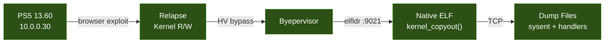

# PS5 Firmware 13.60 - Kernel Dumps

Raw kernel data documented as firmware **13.60** via [Relapse](https://github.com/nicholatian/relapse) + [Byepervisor](https://github.com/Cryptogenic/Byepervisor). These artifacts are historical comparison material for the [V14.10 research](../../README.md); their addresses and handler behavior do not establish 14.10 layout or behavior.

> **Purpose:** Preserve the recorded 13.60 syscall-table and handler artifacts with their provenance and limits. Any cross-firmware comparison requires independent evidence for each firmware; these 13.60 records do not by themselves establish 14.10 behavior or changes.

## Extraction Method



A native PS5 ELF payload uses `kernel_copyout()` to read kernel memory directly, then sends the data over TCP to a receiving host. No browser JS, no crashes, no size limits.

## Kernel Layout

| Field | Value |
|-------|-------|
| Firmware | 13.60 |
| Kernel base (KASLR) | `0xffffffff8a9c0000` |
| Sysent RVA | `+0xe6e5c0` |
| Sysent entries | 679 (48-byte stride) |
| Active handlers | 311 (368 are `nosys` stubs) |
| Sony syscalls (532–676) | 145 entries, 115 with real handlers and 30 `nosys` stubs |

## Files

| File | Size | Description |
|------|------|-------------|
| `sysent_raw.bin` | 32,592 B | Complete sysent table — 679 entries x 48 bytes |
| `sysent_index.json` | ~100 KB | Parsed sysent: syscall number, narg, sy_call address + RVA |
| `kernel_base.txt` | 50 B | KASLR base for this dump session |
| `ucred.bin` | 256 B | Process credential structure |
| `handler_532.bin` – `handler_676.bin` | 4,096 B each | First 4KB at each syscall's resolved handler address, including stubs |

### sysent_index.json Format

Each entry in the `entries` array:

```json
{
  "num": 532,
  "narg": 3,
  "sy_call": "0xffffffff8b5f1a00",
  "sy_call_off": "0xc31a00"
}
```

- `num` — syscall number
- `narg` — argument count
- `sy_call` — absolute handler address (session-specific, KASLR'd)
- `sy_call_off` — offset from kernel base (stable across boots)

### Handler Bins

Each `handler_NNN.bin` is the first 4,096 bytes of raw x86-64 machine code at `sy_call` for that syscall. Disassemble with:

```bash
objdump -D -b binary -m i386:x86-64 handler_532.bin
```

## Cross-Firmware Diffing

The 13.60 capture independently verifies this firmware's sysent RVA at `+0xe6e5c0`. This repository has no verified 14.10 sysent/kernel dump, so the claim that the RVA matches on 14.10 is **not established by the files here**. Even if the table RVA is the same, that alone says nothing about whether handler bodies or security checks match. A meaningful cross-firmware diff requires a verified 14.10 image and matching handler identification.

To diff a specific handler between firmware versions:

```bash
# Mask relocation-sensitive bytes, then compare
python3 tools/differ.py docs/dumps_13.60/handler_572.bin docs/dumps_14.10/handler_572.bin
```

Key things to look for:
- **New bounds checks** — Sony patching a vulnerability we can still hit on 14.10
- **Removed code paths** — features disabled between versions
- **Changed argument validation** — looser checks on 14.10 = potential attack surface

## Known Offsets (13.60)

These are confirmed via `kernel_copyout()` with full kernel R/W:

| Symbol | RVA | Notes |
|--------|-----|-------|
| sysent table | `+0xe6e5c0` | 679 entries, 48B stride |
| nosys handler | `+0x265760` | Stub for unimplemented syscalls |

## Next Steps

1. **Expand the image capture** — the fixed ranges below are captured; full section boundaries and module inventory remain separate work.
2. **Diff every Sony handler** against a verified 14.10 kernel-code image (not syscall probe results) to identify code changes
3. **Update to 14.00** and validate whether bugs found on 13.60 survive the intermediate firmware
4. **Build a complete symbol table** from the full `.text` dump via signature matching

## Related

- [V14.10 Research README](../../README.md) — the main research targeting current firmware
- [Attack Surface Map](../ATTACK_SURFACE.md) — complete syscall status for 14.10
- [Findings](../FINDINGS.md) — detailed technical findings from probing
- [Strategy](../STRATEGY.md) — exploit strategy and dead ends
- [Cross-firmware pattern research](../CROSS_FIRMWARE_PATTERN_RESEARCH.md) — 13.60 handler analysis correlated with saved 14.10 probe evidence
- [Secondary exploit audit](../SECONDARY_EXPLOIT_AUDIT_13.60.md) — static audit scope, AIO handler map, and corrected 14.10 probe coverage

## Direct-address capture (2026-10-17)

The native dumper uses `kernel_copyout()` with 16 KiB chunks and a 100 ms pause between reads. It sends each labeled chunk to the LAN receiver at `10.0.0.231:8888/dump`. A failed kernel read becomes a zero-filled chunk; each binary has a `.failmap` sidecar where byte `1` means that chunk was zero-filled and `0` means the read succeeded. `dump_progress.json` is refreshed every 256 chunks and after each region.

The three requested ranges are:

| File | Start relative to kernel base | Size | Notes |
|---|---:|---:|---|
| `kernel_text.bin` | `0x0` | `0xe6e5c0` | Requested prefix ending at the sysent RVA. |
| `kernel_data.bin` | `0x1000000` | `0x400000` | Requested 4 MiB sample. |
| `sysent_area.bin` | `0xe6d5c0` | `0x10000` | 64 KiB around the sysent address. |

These are fixed requested ranges, not complete ELF section boundaries. The local 13.60 layout analysis records `.text` ending at offset `0xcc0000`, with data beginning there; therefore `kernel_text.bin` crosses into data and `kernel_data.bin` begins partway into data. Treat the filenames as labels for the requested ranges, not claims that they contain entire sections. The requested kernel base is `0xffffffff8a9c0000`. The files match the manifest's requested sizes, and the sysent bytes at offset `0x1000` in `sysent_area.bin` match `sysent_raw.bin` byte-for-byte. The V13.60 repository does not contain `.failmap` sidecars for `kernel_text.bin` or `kernel_data.bin`, so it cannot independently establish whether those ranges contain zero-filled failed reads. Its `dump_progress.json` records only `sysent_area.bin` as 4/4 chunks with zero zero-filled chunks.
